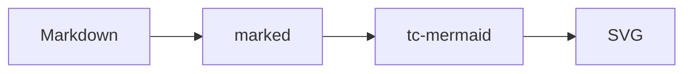
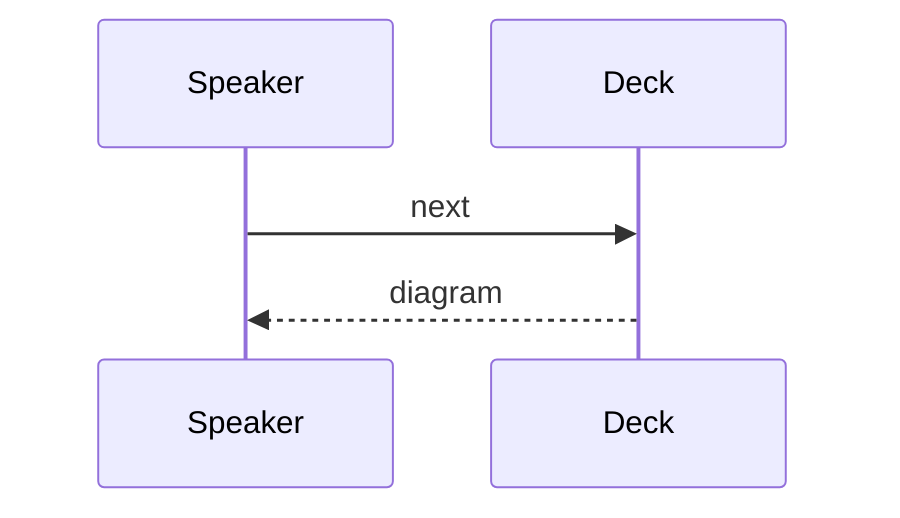
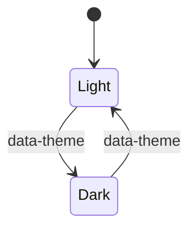
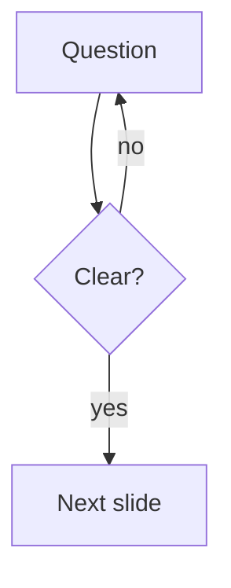

<!-- .slide: class="transition" -->

# Mermaid diagrams

##==##

# Draw a diagram from a code block

A fenced block whose language is `mermaid` becomes an SVG, drawn in the browser. It fills the slide by default. Nothing is downloaded when a deck has no diagram.

##==##

# Choose its size

An `h-*` class sets the height of the diagram, the SVG fits inside.

##==##

# Zoom in or out

`zoom-50` to `zoom-300` scale the diagram (here `zoom-150`).

##==##

# Animate it like any other element

Fragment words (`fragment`, then `fade-up`…) go on the figure, so reveal.js animates the whole diagram.

