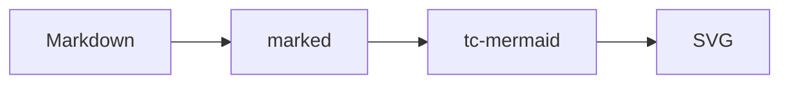
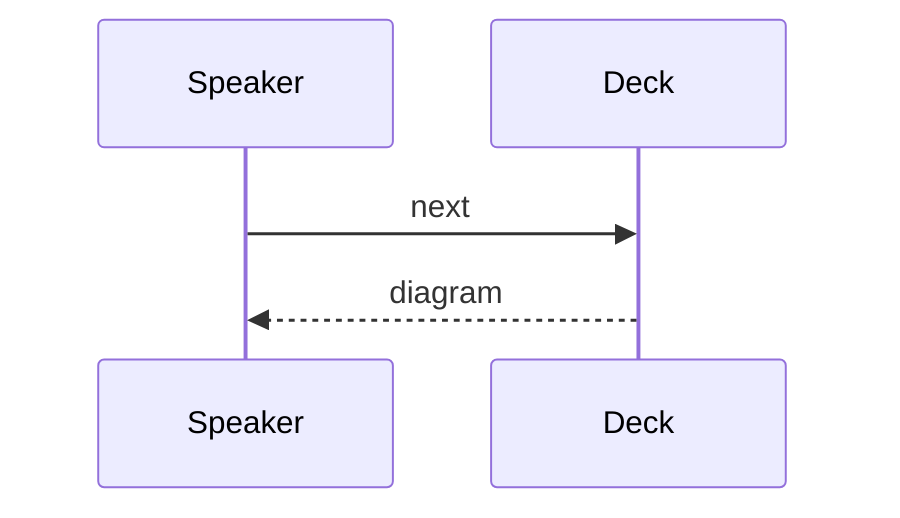
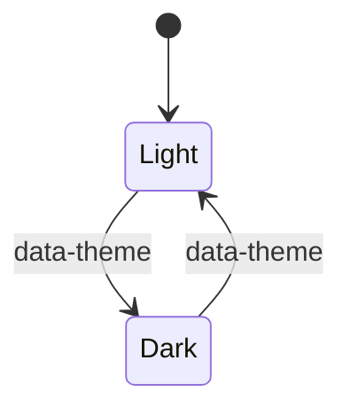

<!-- .slide: class="transition" -->

# Mermaid diagrams

##==##

# Draw a diagram from a code block

A fenced block whose language is `mermaid` becomes an SVG, drawn in the browser. Nothing is downloaded when a deck has no diagram.

##==##

# Animate it like any other element

Fragment words (`fragment`, then `fade-up`…) go on the figure, so reveal.js animates the whole diagram.

##==##

# Follow the theme

The diagram uses the Mermaid theme that matches `data-theme`: switch the theme and reload to compare.

