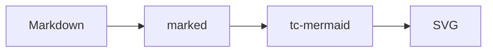
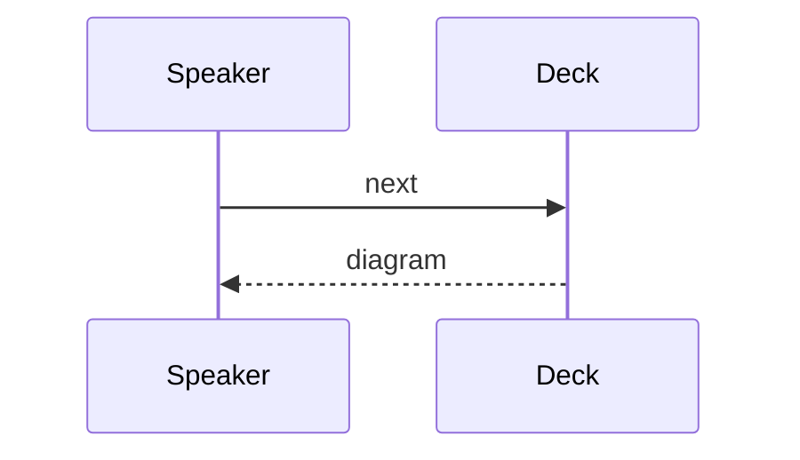
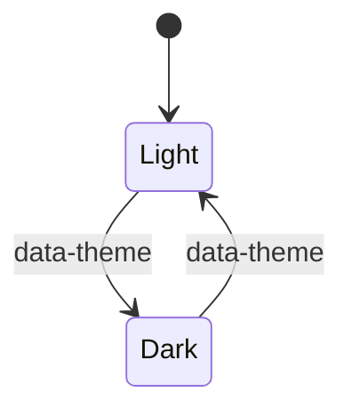
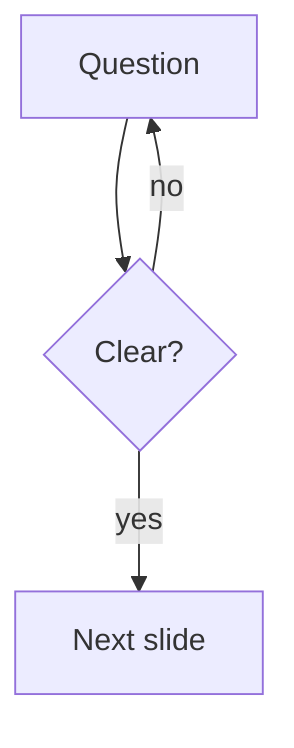
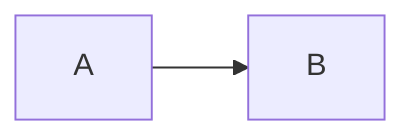

<!-- .slide: class="transition" -->

# Mermaid diagrams

##==##

# Draw a diagram from a code block

A fenced block whose language is `mermaid` becomes an SVG, drawn in the browser. It fills the slide by default. Nothing is downloaded when a deck has no diagram.



##--##

<!-- .slide: class="with-code" -->

# Code to produce / Markdown

````markdown
# Draw a diagram from a code block

A fenced block whose language is `mermaid` becomes an SVG.


````

Every word after `mermaid` is a CSS class of the diagram (`center` here). The full reference is `docs/mermaid.md`.

##==##

# Choose its size

An `h-*` class sets the height of the diagram, the SVG fits inside.



##--##

<!-- .slide: class="with-code" -->

# Code to produce / Markdown

````markdown
# Choose its size

An `h-*` class sets the height of the diagram, the SVG fits inside.


````

Without `h-*`, the diagram fills the slide minus the room of the title (`--tc-mermaid-reserved-height`).

##==##

# Zoom in or out

`zoom-50` to `zoom-300` scale the diagram (here `zoom-150`).



##--##

<!-- .slide: class="with-code" -->

# Code to produce / Markdown

````markdown
# Zoom in or out

`zoom-50` to `zoom-300` scale the diagram (here `zoom-150`).


````

Steps of 25. For another value: `<!-- .element: style="--tc-mermaid-zoom: 1.4" -->`.

##==##

# Animate it like any other element

Fragment words (`fragment`, then `fade-up`…) go on the figure, so reveal.js animates the whole diagram.



##--##

<!-- .slide: class="with-code" -->

# Code to produce / Markdown

````markdown
# Animate it like any other element


````

`fragment` makes the block a fragment, the other words choose how it appears.

##--##

<!-- .slide: class="with-code" -->

# Anything else: `.element`

````markdown


<!-- .element: id="pipeline" data-step="2" aria-label="Build pipeline" -->
````

An `id`, a `data-*`, a `style`, an `aria-label`… go on the figure with reveal.js `<!-- .element: … -->`, right after the block.
