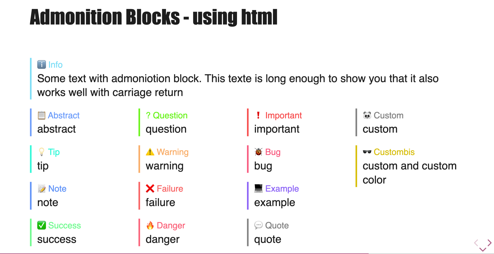
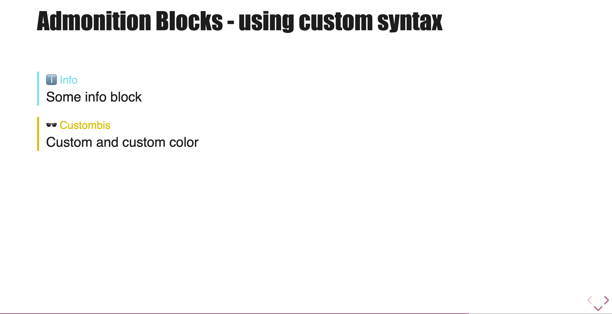

# Admonitions

Admonitions are special blocks of text that highlight information, such as notes, tips, or warnings. Talk-Control provides a simple syntax to create them in your Markdown files.

## Usage

To create an admonition, use the following syntax, starting and ending with `!!!`:

```markdown
!!! type
Your content here. It can span multiple lines.
!!!
```

-   `type`: The type of admonition you want to create.

For example:

```markdown
!!! note
This is a note. It contains some important information.
!!!
```

This will be rendered as a styled block with a "📝 Note" title.

## Available Types

Here is a list of the pre-configured admonition types you can use:

| Type        | Rendered Title | Color     |
| ----------- | -------------- | --------- |
| `abstract`  | 📋 Abstract    | `#236af7` |
| `info`      | ℹ️ Info        | `#0b7e9c` |
| `tip`       | 💡 Tip         | `#05836e` |
| `note`      | 📝 Note        | `#266bf5` |
| `success`   | ✅ Success     | `#058722` |
| `question`  | ? Question     | `#378407` |
| `warning`   | ⚠️ Warning     | `#b75b07` |
| `failure`   | ❌ Failure     | `#e90a0a` |
| `danger`    | 🔥 Danger      | `#e80729` |
| `important` | ❗ Important   | `#e90a0a` |
| `bug`       | 🐞 Bug         | `#e70a3d` |
| `example`   | 💻 Example     | `#8153f5` |
| `quote`     | 💬 Quote       | `#747474` |



### Accessible colors (WCAG AA)

Each type's border and title color is darkened, within its original hue
family, to reach at least a **4.5:1** contrast ratio against the default
light theme's white background (WCAG 1.4.3) — the border also keeps at
least **3:1** (WCAG 1.4.11), automatically satisfied since 4.5:1 is the
stricter of the two. This is a visual change from earlier versions: the
admonition colors are noticeably darker than before.

This fix only targets the library's default **light** theme. The library
does not ship a dark theme (see `demo/theme-dark.css`, which is specific to
the demo and not part of the published package): if your deck defines a
dark background, re-check the contrast of these colors (or your own
overrides) against it yourself, the same way you would for any other color
in your theme.

## Custom Admonitions

If the predefined types don't fit your needs, you can create a custom admonition.

### Custom Title and Icon

Use the `custom` type and provide a title/icon using the `tc-admonition-type` attribute.

```markdown
!!! custom tc-admonition-icon="🐼 Panda Facts"
Pandas are native to central China.
!!!
```

### Custom Color

You can also specify a custom color for the left border and the title using the `tc-admonition-color` attribute. The value should be a valid CSS color.

```markdown
!!! custom tc-admonition-type="🕶️ Custom" tc-admonition-color="#d7be00"
Custom and custom color
!!!
```

#### Choosing an accessible custom color

The `custom` type's color is entirely up to you, and the library does not
validate it. To keep your `custom` admonitions as readable as the
pre-configured types, pick a color that reaches at least a **4.5:1**
contrast ratio against the background it is used on (white by default) —
the same rule applied above to the 13 built-in types. Most browser dev
tools (e.g. Chrome DevTools' color picker) show a live contrast ratio, or
you can use any WCAG contrast checker (for example
[WebAIM's Contrast Checker](https://webaim.org/resources/contrastchecker/)).



## Use comment syntax

To use revealJS comment syntax you can use the following code

```md
Some info block

<!-- .element: class="admonition info" -->

Custom and custom color

<!-- .element: class="admonition custom" data-admonition-icon="🕶️ Custom" style="--tc-admonition-bg-color:#d7be00;" -->
```
