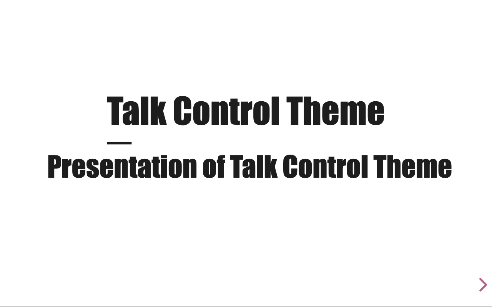
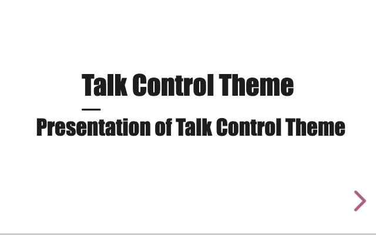
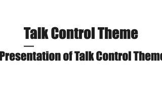

# Zoom (WCAG 1.4.4) and reflow (WCAG 1.4.10) on the reveal.js canvas: documented limitation

## Context and Problem Statement

reveal.js renders a presentation as a single fixed-aspect-ratio canvas
(`config.width` × `config.height`, 960×700 by default) that is continuously
rescaled with a CSS `transform: scale()` so it always fills whatever viewport
is available. That model is what lets a deck look right on a phone, a laptop,
and a projector without any authoring effort — but it is in direct tension
with two WCAG 2.2 AA success criteria that assume ordinary document flow:

-   **1.4.4 Resize Text**: text can be resized up to 200% without loss of
    content or functionality.
-   **1.4.10 Reflow**: content can be presented without loss of information
    or functionality, and without requiring scrolling in two dimensions, at a
    width equivalent to 320 CSS px (the standard 400%-zoom test size on a
    1280px-wide reference display).

Sub-issue of #1 (PR 11 of its validated plan). Is this genuinely a
structural limitation of the canvas model, or can an alternative view (a
list/print rendering) make the deck satisfy these two criteria? This ADR
records the answer so #109 (the accessibility guide) and any future issue in
this area can link to it instead of re-litigating the question.

## Considered Options

-   Keep the canvas model as-is and document the limitation for authors and
    consumers.
-   Build a parallel, reflow-friendly "list view" that renders the same
    Markdown content as an ordinary single-column document, independent of
    the reveal.js stage.
-   Repurpose the existing `print-pdf` static layout — already shipped for
    the `talk-control-a11y` CLI's content-scan pass (#122) — as an on-screen
    reflow fallback at high zoom.

## Decision Outcome

Chosen option: "Keep the canvas model as-is and document the limitation",
because both alternatives were measured against the actual demo and neither
would satisfy 1.4.10 without an engineering investment disproportionate to
this library's scope — building a second rendering pipeline outside the
slide-canvas model that `talk-control-revealjs-extensions` exists to provide
(see evidence below, and the _Out of scope_ note in #108: an alternative
view would be its own, separately-justified issue, not a side effect of
documenting this one).

## Pros and Cons of the Options

### Keep the canvas model, document the limitation

-   Good, because it ships immediately with zero change to `src/` and zero
    regression risk.
-   Good, because it unblocks #109, which can link a stable, final answer
    instead of leaving the question open.
-   Bad, because decks built with this library genuinely do not satisfy
    1.4.4/1.4.10 at the canvas level; authors and consumers who need full AA
    conformance must be told explicitly (#109) and pointed at mitigations
    (see _More Information_).

### A parallel reflow/list view

-   Good, because it is the only option that would actually satisfy 1.4.10's
    "no two-dimensional scrolling" requirement for prose content.
-   Bad, because it duplicates the entire Markdown-to-DOM pipeline (the
    `talk-control-markdown` plugin and every `marked` extension — admonitions,
    columns, icons, QR codes, backgrounds) in a second, parallel rendering
    mode outside reveal.js's section/stack/fragment model, maintained
    indefinitely alongside the first.
-   Bad, because it is explicitly out of scope for #108 ("a new issue if the
    decision calls for it").

### Reuse `print-pdf` as the on-screen reflow fallback

-   Neutral, because `print-pdf` is already shipped (#122) and already
    proves the slide DOM can be flattened out of the transformed stage.
-   Bad (measured), because `Reveal.getComputedSlideSize()` sizes every
    `.pdf-page` from `config.width`/`config.height` alone — never from the
    viewport at the time of printing — so the generated document is pinned
    to a fixed pixel width (≈1996px in the demo) regardless of the browser
    window or zoom level. It is the opposite of reflow: a frozen,
    print-resolution layout, not a responsive one (see measurements below).
-   Bad, because even ignoring sizing, `print-pdf` has none of reveal.js's
    live navigation or keyboard/focus model — wiring it up as an on-screen
    mode would mean building essentially the same amount of new interaction
    code as the list-view option above.

## Consequences

-   Good, because no code changes to `src/`: this PR is documentation-only.
-   Good, because `docs/accessibility.md` (#109) gets a stable, linkable
    answer to "why doesn't zoom work on my slides" instead of silence.
-   Bad, because the structural gap remains: a deck built with this library
    cannot claim WCAG 2.2 AA conformance on 1.4.4/1.4.10 as shipped.
-   Neutral, because this decision is specific to reveal.js's current
    engine; if upstream reveal.js ever ships a native reflow/responsive mode,
    this ADR should be revisited and, if superseded, replaced rather than
    edited in place (see `docs/adr/README.md`).

## More Information

### Methodology

Evidence was captured on 2026-11-10 against `demo/` built from this
branch (based on `upstream/main` @ `01417d0`), using Chromium through
Playwright (already a project dependency via `@axe-core/playwright`/the
`talk-control-a11y` CLI, and via the project's own e2e suite). Zoom was
simulated with the standard WCAG reflow-testing technique (Understanding SC
1.4.10, technique G206): a 1280×800 CSS-pixel viewport as the 100% baseline,
halved to 640×400 to emulate 200% zoom, and quartered to 320×200 to emulate
400% zoom. Real browser zoom shrinks `window.innerWidth`/`innerHeight` in
CSS pixels the same way a narrower viewport does, which is exactly what
reveal.js's layout code reads to compute its scale — so the two are
equivalent for this purpose.

### What the source does (`node_modules/reveal.js/js/reveal.js`, `layout()`)

On every resize (including one caused by real browser zoom), reveal.js
recomputes:

```js
scale = Math.min(
    presentationWidth / config.width,
    presentationHeight / config.height
);
scale = Math.max(scale, config.minScale); // default 0.2
scale = Math.min(scale, config.maxScale); // default 2.0
// then applied as: transform: scale(...)
```

`config.width`/`config.height` (960×700 by default) never change — only the
transform scale does, so the canvas always re-fits the viewport. Zooming in
shrinks the available viewport exactly as much as it tries to enlarge the
content, netting out to no visible magnification.

### What was measured (normal, on-stage view)

| Viewport (zoom-equivalent) | `window.innerWidth` | `.reveal .slides` transform scale |
| -------------------------- | ------------------: | --------------------------------: |
| 1280×800 (100%, baseline)  |                1280 |                              0.64 |
| 640×400 (200%)             |                 640 |                              0.32 |
| 320×200 (400%)             |                 320 |       1 (no transform — see note) |

The scale exactly halves alongside the viewport (0.64 → 0.32): the net
magnification a user gets from 200% browser zoom is 1×, not 2×.





At the 320×200 (400%-zoom-equivalent) viewport, the scale clamps to `1`
(no transform at all) rather than continuing to shrink proportionally — a
quirk not root-caused further here, since the outcome is already a clear
failure: the heading text is clipped mid-word against the slide edge, and
reveal.js offers no scrollbar to reach the rest. This is a direct SC
1.4.4/1.4.10 failure (content lost, not just "not bigger").



### What was measured (`print-pdf` view)

`print-pdf`'s `.pdf-page` elements are sized once from `config.width`/
`config.height`, independent of the viewport, yielding a document
`scrollWidth` of ≈1996px at every tested viewport (1280×800, 640×400,
320×200 alike). The document already overflows a full 1280×800 desktop
viewport at baseline (no zoom involved at all):


At the 320×200 (400%-zoom-equivalent) viewport, only a blank corner of the
oversized fixed canvas is visible — nothing readable, nothing to scroll to
usefully without already knowing the document's absolute pixel layout:


### Side observation (not part of this decision)

`demo/index.html`'s `<meta name="viewport" ... maximum-scale=1.0
user-scalable=no>` additionally blocks pinch-zoom on mobile for no benefit,
given the above. Worth a small, independent follow-up (consuming decks, not
this library's own output), not blocking #108 or #109.

### Links

-   Parent: #1. Consumed by: #109 (`docs/accessibility.md`, not yet
    created at the time of writing).
-   `talk-control-a11y`'s own use of `print-pdf` as a content-scan pass:
    `src/a11y/cli/run.ts`.
