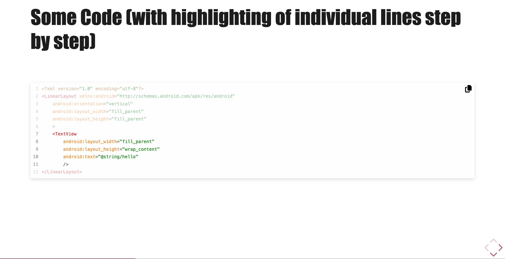
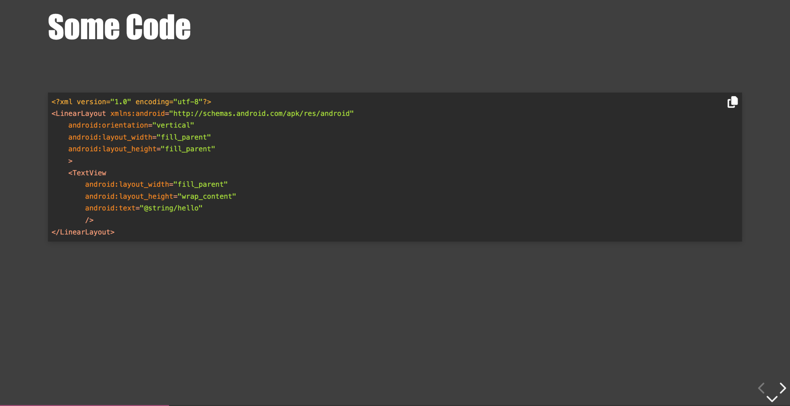
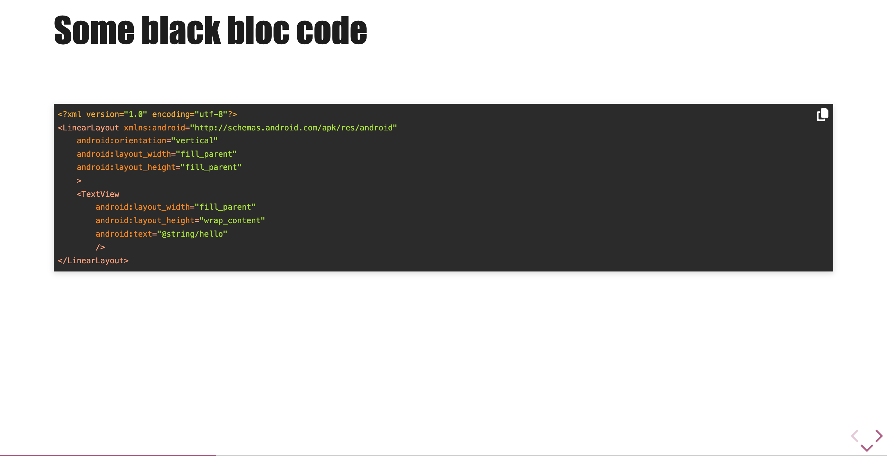
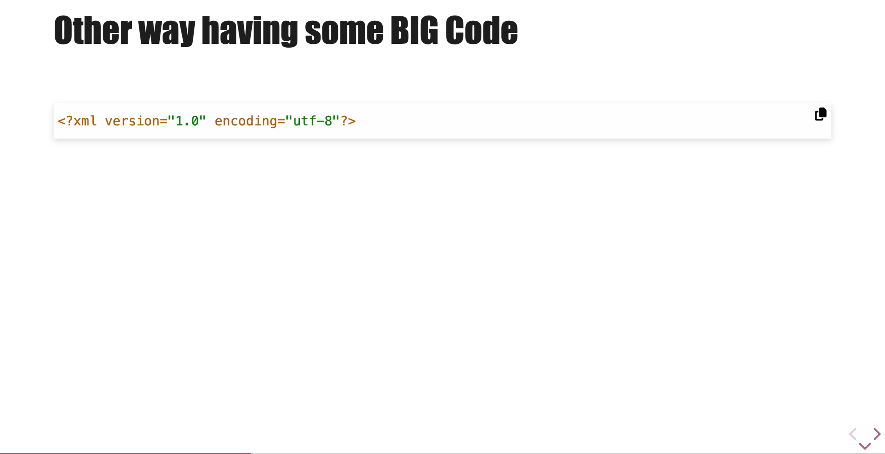
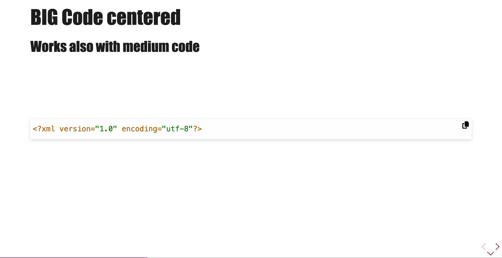

# Slide with code

In addition to what RevealJS offers : [RevealJS code features](https://revealjs.com/code/)

Default theme applied by TalkControl is `a11y-light`;



## Switch to dark background slides

In this mode, the theme applied is `a11y-dark`



## Light slide with dark code background

In this mode, the theme applied is `a11y-dark`



## Copy to clipboard

TalkControl comes with a copy to clipboard icon that includes in clipboard the content of code slide.

/!\ This will work only if you have defined an icon library to use (see [icons](./icons.md))

### Configuration

The first icon library you passed in the `ThemeInitializer.init` method will be used.

```javascript
tcMarkedOptions: {
    fontIcons: [
        fontAwesomeIconPack(),
        featherIconPack(),
    ],
},
```

Here, the copy icon of FontAwesome will be used.

### Deactivation

You can desactivate this behaviour by simply setting to `false` the option `activeCopyClipboard` in `ThemeInitializer.init` method. Default value is `true`

## Size of your code

You can choose between 2 font-size for your code : medium or big. Medium is the default size (screenshot).

### Force Big code

To force big size, simply suffix your code with class "big-code"

````md
<!-- .slide: class="with-code" -->

## Some BIG Code

```xml
<?xml version="1.0" encoding="utf-8"?>
```

<!-- .element: class="big-code" -->
````



### Force Medium code

To force medium size, simply suffix your code with class "medium-code"

````md
<!-- .slide: class="with-code" -->

## Some Medium Code

```xml
<?xml version="1.0" encoding="utf-8"?>
```

<!-- .element: class="medium-code" -->
````

### Change default size

By default the size of your code is "medium" if you prefer having only "big" code by default, simply define at the top of your css the custom properties like this:

```css
body {
    --tc-code-font-size: var(--tc-big-code-font-size);
    --tc-code-line-height: var(--tc-big-code-line-height);
}
```

### Change the sizes

There are custom properties defined to fix the size of your code. You can look at the code section [here](../src/scss/theme/talk-control-custom-properties.scss)

## Displaying more lines on screen

By default there will be only 20 lines of code displayed. If you need more space, you could use the class `max-height` that will increase the number of lines to 30 lines.

The code block's height is actually capped by **the lesser of two limits**: the line-count ceiling above (`--tc-code-max-lines`) and the height actually available on the current slide. This second, slide-aware limit is what lets reveal.js's highlight plugin scroll and center a highlighted line even on a `big-code` block tall enough to exceed the configured line count: the `<code>` box keeps an internal scrollbar instead of overflowing past the edge of the slide.

The vertical space reserved around the code block (for the slide's title and margins) is controlled by `--tc-code-reserved-height` (default `340px`). If your slide layout leaves more or less room above/below the code block than the default assumes, override this custom property to recalibrate the limit:

```css
body {
    --tc-code-reserved-height: 400px;
}
```

````md
<!-- .slide: class="with-code-dark max-height" -->

## Some Code with lots of code

```xml
<?xml version="1.0" encoding="utf-8"?>
<LinearLayout xmlns:android="http://schemas.android.com/apk/res/android"
    android:orientation="vertical"
    android:layout_width="fill_parent"
    android:layout_height="fill_parent"
    >
    <TextView
        android:layout_width="fill_parent"
        android:layout_height="wrap_content"
        android:text="@string/hello"
        />
    <TextView
        android:layout_width="fill_parent"
        android:layout_height="wrap_content"
        android:text="@string/hello"
        />
    <TextView
        android:layout_width="fill_parent"
        android:layout_height="wrap_content"
        android:text="@string/hello"
        />
    <TextView
        android:text="@string/hello"/>
</LinearLayout>
```
````

## Center your code on slide

It often happens that you only display one code block on screen and you want it to be centered. To do this, add the class `alone` to the code block

````md
<!-- .slide: class="with-code big-code" -->

## BIG Code centered

### Works also with medium code

```xml
<?xml version="1.0" encoding="utf-8"?>
```

<!-- .element: class="alone" -->
````



This will only work if you have one code block!

## Changing the highlight.js theme

TalkControl embeds three highlight.js themes you can't remove from the main stylesheet: `tomorrow` (global, outside any `with-code*` slide), `a11y-light` (`with-code` slides) and `a11y-dark` (`with-code-dark` and `with-code-bg-dark` slides).

To use a different theme on `with-code*` slides, the package also ships a selection of highlight.js themes as ready-made, scoped CSS files under `dist/highlight/`. Load the one you want **after** TalkControl's own stylesheet, with a plain `<link>` or a CSS `import` — no Sass toolchain required on your side:

```html
<!-- path into node_modules, as served by your own build (see the demo's
     scripts/prepare-demo.ts for how this repo does it) -->
<link rel="stylesheet" href="talk-control-revealjs-extensions.css" />
<link
    rel="stylesheet"
    href="talk-control-revealjs-extensions/highlight/atom-one-light.light.css" />
<link
    rel="stylesheet"
    href="talk-control-revealjs-extensions/highlight/atom-one-dark.dark.css" />
```

```css
/* or, from a bundler that resolves package imports (Vite, webpack, …) */
@import '@talk-control/talk-control-revealjs-extensions/highlight/atom-one-light.light.css';
@import '@talk-control/talk-control-revealjs-extensions/highlight/atom-one-dark.dark.css';
```

**Loading order matters.** Every rule in these files has the exact same selector specificity as the embedded `a11y-light`/`a11y-dark` ones it replaces, so the override only works because it's loaded later in the cascade. Load it after TalkControl's stylesheet, never before.

### Naming

Each theme ships as **two independent files**: `<theme>.light.css` (scoped under `.with-code`) and `<theme>.dark.css` (scoped under `.with-code-dark, .with-code-bg-dark`). A theme has no "light" or "dark" nature of its own — you decide which file goes on which kind of slide, so nothing stops you from loading `atom-one-light.dark.css` on a dark slide if you like its palette there. Both files are standalone: a `.light.css` file never needs its `.dark.css` counterpart, or vice versa.

Each file also resets the bold/italic styling the embedded `a11y-light`/`a11y-dark` themes apply to `.hljs-keyword`/`.hljs-selector-tag` under forced-colors mode, so none of it leaks into the theme you load.

### Themes shipped today

Each theme below is available as both `<name>.light.css` and `<name>.dark.css` (see _Naming_ above):

-   `a11y-light`
-   `a11y-dark`
-   `atom-one-light`
-   `atom-one-dark`
-   `github`
-   `github-dark`
-   `monokai`
-   `nord`
-   `vs`
-   `vs2015`
-   `docco`
-   `xcode`
-   `tokyo-night-light`
-   `tokyo-night-dark`
-   `night-owl`

Preview any of them at [highlightjs.org/demo](https://highlightjs.org/demo) (pick the theme from the dropdown). This is a fixed selection, not every highlight.js theme, picked for variety and recognizability. The full catalog lives in [`node_modules/highlight.js/scss/`](https://github.com/highlightjs/highlight.js/tree/main/src/styles) in any project that depends on `highlight.js`.

### Adding or removing a theme (maintainers)

The selection above is generated at build time by [`scripts/build-highlight-themes.ts`](../scripts/build-highlight-themes.ts), from the `THEMES` list in [`scripts/utils/highlight-themes.utils.ts`](../scripts/utils/highlight-themes.utils.ts). To add a theme, add its `highlight.js/scss/<name>.scss` file name as one line in that list; to remove one, delete its line. The next `npm run build` regenerates `dist/highlight/` accordingly — nothing else to update, since `package.json`'s `exports` entry (`./highlight/*`) resolves any file name automatically.

### Dark background color

A dark theme's own background color may not match TalkControl's default. Adjust the `--tc-code-dark-background` custom property (default `#3f3f3f`) to the theme's actual background, for example:

```css
:root {
    --tc-code-dark-background: #282c34; /* atom-one-dark's background */
}
```

### Overriding the global theme (`tomorrow`)

Code outside any `with-code*` slide still falls back to the globally applied `tomorrow` theme, which isn't part of the `dist/highlight/` selection. Override it the same way, with unscoped `.hljs-*` selectors loaded after TalkControl's stylesheet.

### Limits

There's no TypeScript option to pick a theme at `ThemeInitializer.init()` time, and no Sass export to compose a theme with `@use … with (…)` (tracked in [#70](https://github.com/TalkControl/talk-control-revealjs-extensions/issues/70)) — overriding with CSS, as described above, is the only supported path today.
