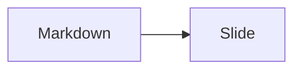
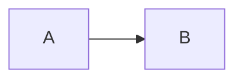

# Mermaid diagrams

Write a diagram as a fenced code block whose language is `mermaid`:

````markdown

````

> **Status:** the Markdown syntax below is in place. The rendering itself (the
> `tc-mermaid` addon and the vendored Mermaid library) comes with the next
> pull requests of [#92](https://github.com/TalkControl/talk-control-revealjs-extensions/issues/92);
> until then the block shows its source.

## Options

Everything after `mermaid` on the opening line is an option. Two forms, mixable
in any order:

| Form           | Result                            | Example                                 |
| -------------- | --------------------------------- | --------------------------------------- |
| `word`         | a CSS class                       | `h-400 center`                          |
| `class="a b"`  | classes, same as bare words       | `class="h-400 center"`                  |
| `name="value"` | an HTML attribute (`'value'` too) | `id="flow" aria-label="Build pipeline"` |

````markdown

````

### Where options land

The block becomes a `<figure>` holding two elements: the **diagram** (that
receives the SVG) and the **source** (hidden once rendered).

| Option                                                                                                              | Goes on                                |
| ------------------------------------------------------------------------------------------------------------------- | -------------------------------------- |
| Fragment words: `fragment`, `fade-*`, `highlight-*`, `grow`, `shrink`, `strike`, `semi-fade-out`, `current-visible` | the `<figure>` (reveal.js animates it) |
| Any other class (`h-400`, `center`, your own…)                                                                      | the diagram                            |
| Any `name="value"` attribute                                                                                        | the diagram                            |

The size helpers (`h-400`, see [Helpers](./helpers.md)) therefore size the
diagram, not the source.

To customize the `<figure>` itself (any class or attribute), use reveal.js'
own comment right after the block:

````markdown


<!-- .element: class="fragment my-figure" data-id="x" -->
````

reveal.js **replaces** the `class` attribute of the element with the one you
give. This is expected, and the addon finds diagrams through
`figure[data-tc-mermaid]`, never through a class.

### Rules and limits

- Class words must be valid CSS names (`[a-z][a-z0-9-]*`); anything else is ignored.
- Attribute names must be valid HTML names. Event handlers (`onclick`, `onload`…)
  are refused, and the attributes `data-tc-mermaid*` are reserved for the addon.
- When an attribute is repeated, the first one wins.
- Values are quoted, with `"` or `'`; they cannot contain their own quote
  character. In a backtick fence they cannot contain a backtick either (use a
  `~~~` fence).
- The fence follows CommonMark: backticks or tildes, up to 3 spaces of
  indentation, a closing fence at least as long, or none (the block then runs
  to the end of the slide). ` ```mermaidjs ` and ` ``` mermaid ` stay regular
  code blocks.
