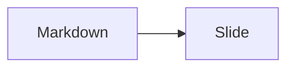
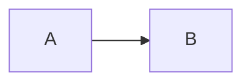

# Mermaid diagrams

Write a diagram as a fenced code block whose language is `mermaid`:

````markdown

````

> **Status:** the Markdown syntax below is in place. The rendering itself (the
> `tc-mermaid` addon and the vendored Mermaid library) comes with the next
> pull requests of [#92](https://github.com/TalkControl/talk-control-revealjs-extensions/issues/92);
> until then the block shows its source.

## What the block becomes

Each block turns into a `<figure>` with two children:

```html
<figure class="tc-mermaid" data-tc-mermaid="0">
    <div class="tc-mermaid-diagram"></div>
    <pre class="tc-mermaid-source">
flowchart LR\n  A["Markdown"] --> B["Slide"]</pre>
</figure>
```

- the **`<figure>`** is the element reveal.js sees in the slide (it is the one
  that animates as a fragment);
- the **diagram** `<div>` receives the rendered SVG;
- the **source** `<pre>` keeps the Mermaid text (hidden once the diagram is
  rendered).

Two ways to customize them, depending on what you want to reach.

## 1. Classes on the diagram: words after `mermaid`

Every word after `mermaid` on the opening line is added as a CSS class on the
**diagram**. It is the same idea as the options of `tc-qrcode`: size helpers
(`h-400`, see [Helpers](./helpers.md)), `center`, or your own class.

````markdown

````

```html
<figure class="tc-mermaid" data-tc-mermaid="0">
    <div class="tc-mermaid-diagram h-400 center my-diagram"></div>
    <pre class="tc-mermaid-source">…</pre>
</figure>
```

The helpers apply to the diagram and not to the figure, so the source `<pre>`
never gets sized, and the theme's `.h-400 + *` rules do not leak to the next
element of the slide.

A word must be a valid CSS class name (`[a-z][a-z0-9-]*`); anything else is
ignored.

## 2. Keywords for the figure: fragment words

Some words animate the block. They are **keywords** that go on the
`<figure>` instead, because reveal.js only animates top-level elements:

`fragment`, `fade-*` (`fade-up`, `fade-in`…), `highlight-*`, `grow`, `shrink`,
`strike`, `semi-fade-out`, `current-visible`.

````markdown

````

```html
<figure class="tc-mermaid fade-up" data-tc-mermaid="0">
    <div class="tc-mermaid-diagram h-400"></div>
    <pre class="tc-mermaid-source">…</pre>
</figure>
```

You can mix both kinds in any order: here `h-400` goes on the diagram and
`fade-up` on the figure.

## 3. Anything else: reveal.js `<!-- .element: … -->`

For a very specific need (an `id`, a `data-*`, a `style`, an `aria-label`, a
custom class on the **figure**…), use the standard reveal.js comment on the
line right after the block. It applies to the figure, like for any other
element of your slides.

````markdown


<!-- .element: class="fragment my-figure" id="pipeline" data-step="2" -->
````

```html
<figure
    class="fragment my-figure"
    id="pipeline"
    data-step="2"
    data-tc-mermaid="0">
    <div class="tc-mermaid-diagram h-400"></div>
    <pre class="tc-mermaid-source">…</pre>
</figure>
```

> **`class` is replaced, not merged.** reveal.js overwrites the `class`
> attribute of the figure with yours: `tc-mermaid` disappears from it (as in
> the example above). It is harmless, the addon finds diagrams through
> `figure[data-tc-mermaid]`, never through a class. Do not write CSS on
> `figure.tc-mermaid` if you use `.element: class=…`; select
> `figure[data-tc-mermaid]` or your own class.

## Which one to use?

| I want to…                                           | Use                                    |
| ---------------------------------------------------- | -------------------------------------- |
| size or center the diagram (`h-400`, `center`)       | a word after `mermaid`                 |
| give the diagram my own CSS class                    | a word after `mermaid`                 |
| animate the diagram (`fragment`, `fade-up`…)         | a word after `mermaid` (or `.element`) |
| set an `id`, a `data-*`, a `style`, an `aria-label`… | `<!-- .element: … -->` (on the figure) |
| a custom class on the figure                         | `<!-- .element: class="…" -->`         |

The info string takes no `name="value"` attributes: only words. Everything
that needs a value goes through `.element`.

## Fences

The fence follows CommonMark: backticks or tildes, up to 3 spaces of
indentation, a closing fence at least as long as the opening one, or none (the
block then runs to the end of the slide). ` ```mermaidjs ` and ` ``` mermaid `
(with a space) stay regular code blocks.
