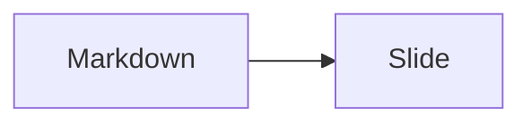
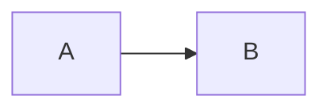

# Mermaid diagrams

Write a diagram as a fenced code block whose language is `mermaid`:

````markdown

````

The diagram is drawn in the browser by [Mermaid](https://mermaid.js.org),
which TalkControl ships (see [Vendored assets](./vendor.md)). It is fetched
**only when the deck contains at least one diagram**: without a block, no
request is made.

The demo has a short walk-through: _Helpers › Mermaid diagrams_
(`demo/markdown/10-helpers/60_mermaid.md`).

## What the block becomes

Each block turns into a `<figure>` with two children:

```html
<figure class="tc-mermaid" data-tc-mermaid="0">
    <div class="tc-mermaid-diagram"></div>
    <pre class="tc-mermaid-source">
flowchart LR\n  A["Markdown"] --> B["Slide"]</pre>
</figure>
```

- the **`<figure>`** is the element reveal.js sees in the slide (it is the one
  that animates as a fragment);
- the **diagram** `<div>` receives the rendered SVG;
- the **source** `<pre>` keeps the Mermaid text (hidden once the diagram is
  rendered).

Two ways to customize them, depending on what you want to reach.

## 1. Classes on the diagram: words after `mermaid`

Every word after `mermaid` on the opening line is added as a CSS class on the
**diagram**. It is the same idea as the options of `tc-qrcode`: size helpers
(`h-400`, see [Helpers](./helpers.md)), `center`, or your own class.

````markdown

````

```html
<figure class="tc-mermaid" data-tc-mermaid="0">
    <div class="tc-mermaid-diagram h-400 center my-diagram"></div>
    <pre class="tc-mermaid-source">…</pre>
</figure>
```

The helpers apply to the diagram and not to the figure, so the source `<pre>`
never gets sized, and the theme's `.h-400 + *` rules do not leak to the next
element of the slide.

A word must be a valid CSS class name (`[a-z][a-z0-9-]*`); anything else is
ignored.

### Size and zoom

By default a diagram **fills a box** as high as the slide minus the room for
the title (1080 − 340 px on a 1920×1080 deck): the SVG is scaled up or down to
fit, keeping its proportions, so a small flowchart is readable from the back
of the room.

- **`h-*`** (`h-400`, `h-600`…) sets the height of that box instead; the SVG
  fits inside it.
- **`zoom-50` … `zoom-300`** (by steps of 25: `zoom-125`, `zoom-150`…) scale the
  drawing around its center on top of that. Above 100 it may overflow the box:
  it is your call.
- For another value, set the custom property yourself:
  `<!-- .element: style="--tc-mermaid-zoom: 1.4" -->` (see section 3).
- The room kept for the title is `--tc-mermaid-reserved-height` (default
  `340px`): change it in your theme if your titles are taller or smaller.

````markdown

````

## 2. Keywords for the figure: fragment words

Some words animate the block. They are **keywords** that go on the
`<figure>` instead, because reveal.js only animates top-level elements:

`fragment`, `fade-*` (`fade-up`, `fade-in`…), `highlight-*`, `grow`, `shrink`,
`strike`, `semi-fade-out`, `current-visible`.

As everywhere in reveal.js, `fragment` is what makes the block a fragment; the
other words only choose _how_ it appears (`fragment fade-up`). `fade-up` alone
animates nothing.

````markdown

````

```html
<figure class="tc-mermaid fragment fade-up" data-tc-mermaid="0">
    <div class="tc-mermaid-diagram h-400"></div>
    <pre class="tc-mermaid-source">…</pre>
</figure>
```

You can mix both kinds in any order: here `h-400` goes on the diagram and
`fragment fade-up` on the figure.

## 3. Anything else: reveal.js `<!-- .element: … -->`

For a very specific need (an `id`, a `data-*`, a `style`, an `aria-label`, a
custom class on the **figure**…), use the standard reveal.js comment on the
line right after the block. It applies to the figure, like for any other
element of your slides.

````markdown


<!-- .element: class="fragment my-figure" id="pipeline" data-step="2" -->
````

```html
<figure
    class="fragment my-figure"
    id="pipeline"
    data-step="2"
    data-tc-mermaid="0">
    <div class="tc-mermaid-diagram h-400"></div>
    <pre class="tc-mermaid-source">…</pre>
</figure>
```

> **`class` is replaced, not merged.** reveal.js overwrites the `class`
> attribute of the figure with yours: `tc-mermaid` disappears from it (as in
> the example above). It is harmless, the addon finds diagrams through
> `figure[data-tc-mermaid]`, never through a class. Do not write CSS on
> `figure.tc-mermaid` if you use `.element: class=…`; select
> `figure[data-tc-mermaid]` or your own class.

## Which one to use?

| I want to…                                                       | Use                                    |
| ---------------------------------------------------------------- | -------------------------------------- |
| size, zoom or center the diagram (`h-400`, `zoom-150`, `center`) | a word after `mermaid`                 |
| give the diagram my own CSS class                                | a word after `mermaid`                 |
| animate the diagram (`fragment fade-up`…)                        | a word after `mermaid` (or `.element`) |
| set an `id`, a `data-*`, a `style`, an `aria-label`…             | `<!-- .element: … -->` (on the figure) |
| a custom class on the figure                                     | `<!-- .element: class="…" -->`         |

The info string takes no `name="value"` attributes: only words. Everything
that needs a value goes through `.element`.

## Fences

The fence follows CommonMark: backticks or tildes, up to 3 spaces of
indentation, a closing fence at least as long as the opening one, or none (the
block then runs to the end of the slide). ` ```mermaidjs ` and ` ``` mermaid `
(with a space) stay regular code blocks.

## Rendering

The `tc-mermaid` addon draws the diagrams once the deck is ready:

- in an off-screen container, one diagram at a time, the **current slide
  first**, so a diagram on a hidden slide or in a fragment gets the right size;
- after the web fonts are loaded, with the font of the deck (`--r-main-font`);
- with `?print-pdf`, before reveal.js paginates the PDF: every diagram is in
  the PDF.

The `data-tc-mermaid-state` attribute of the `<figure>` is `rendering`,
`rendered` or `error`. The source `<pre>` is hidden once drawn.

### Light and dark

The Mermaid theme follows the `data-theme` of the deck: `dark` gives Mermaid's
`dark` theme, anything else its `default`. Map your own themes, or force one:

```ts
ThemeInitializer.init({
    tcMarkedOptions: {
        mermaid: {
            themes: { corporate: 'neutral' }, // data-theme -> Mermaid theme
        },
    },
});
```

### Mermaid configuration

`config` is given to
[`mermaid.initialize()`](https://mermaid.js.org/config/schema-docs/config.html)
over the TalkControl defaults (`startOnLoad: false`, `securityLevel: 'strict'`,
`suppressErrorRendering: true`, the theme and the font of the deck):

```ts
ThemeInitializer.init({
    tcMarkedOptions: {
        mermaid: {
            config: { flowchart: { curve: 'linear' }, theme: 'forest' },
        },
    },
});
```

A `config.theme` wins over the `data-theme` mapping.

> **Security.** `securityLevel: 'strict'` (the default) encodes HTML in labels
> and disables clicks. Use `'loose'` only for decks you author yourself: it
> allows click handlers and HTML labels.

### When something is wrong

A diagram never stops the presentation:

- **syntax error** in one diagram: its figure goes to `error`, shows the
  message and its source, and the error is logged in the console
  (`tc-mermaid: diagram 2 failed to render`). The other diagrams are drawn;
- **Mermaid cannot be loaded** (the `vendor/` folder is not served next to the
  library script): every diagram shows the message, one error is logged. See
  [Vendored assets](./vendor.md).
