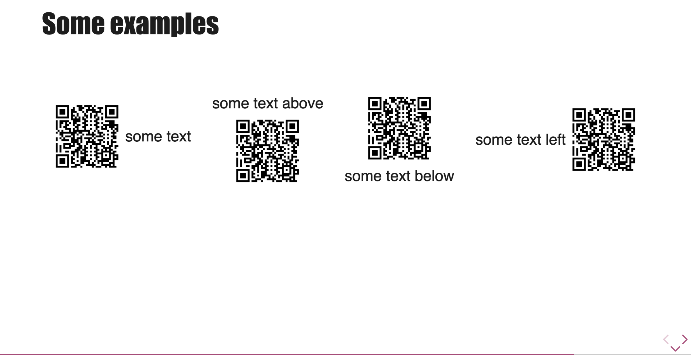

# QR Codes

Talk-Control provides a convenient way to generate and display QR codes directly within your slides. This is perfect for sharing links, contact information, or any other text-based data with your audience.

## Usage

To generate a QR code, use a syntax similar to an image, but with the `tc-qrcode` keyword in the title.

```markdown
 some text
```

-   `text-to-encode`: The data you want the QR code to contain. This is typically a URL.
-   `tc-qrcode`: The mandatory keyword that triggers the QR code generation.
-   `some text`: the 'legend' text associated
-   the part with `tc-qrcode` will arrive in class attribute, so you can add several classes in it

by default the size of QrCode is 500px square

## Layout with Text

You can easily display text alongside your QR code. By default, the text will appear to the right of the image.
To control the position of the text relative to the QR code by adding layout classes :

-   `.text-left` class to place the text to the left of the QR code.
-   `.text-below` class to place the text underneath the QR code.
-   `.text-above` class to place the text above the QR code.

```markdown
 some text

 some text above

 some text below

 some text left
```



## Accessibility

By default, the generated `` gets a hardcoded, English-only `alt` text ("qrcode with base64 information, original text is: ..."). Per [WCAG 1.1.1 and 3.1.2](https://www.w3.org/WAI/WCAG21/Understanding/non-text-content.html), you can override it - per QR code, and/or for every QR code at once, localized to your deck's language.

### Per QR code: `tc-qrcode-alt`

Use the `tc-qrcode-alt="..."` pseudo-attribute to give a specific QR code its own alt text:

```markdown

```

The alt text must be wrapped in double quotes (`"..."`), while the Markdown title itself must stay wrapped in single quotes (`'...'`), so the two don't conflict. It can't itself contain a double quote.

### For every QR code: `defaultAlt`

Configure a library-wide default via `tcMarkedOptions.qrcode` in `ThemeInitializer.init`, applied to every QR code that doesn't set its own `tc-qrcode-alt`. Use the `{{text}}` placeholder for the encoded text:

```javascript
ThemeInitializer.init({
    // ... other options
    tcMarkedOptions: {
        qrcode: {
            defaultAlt: 'QR code linking to {{text}}',
        },
    },
});
```

To localize it according to the deck's language, pass a map keyed by the same uppercase language code the [i18n](./i18n.md) addon reads from `data-lang` (eg. `EN`, `FR`):

```javascript
tcMarkedOptions: {
    qrcode: {
        defaultAlt: {
            EN: 'QR code linking to {{text}}',
            FR: 'QR code pointant vers {{text}}',
        },
    },
},
```

The current `data-lang` is resolved the same way the `tc-i18n` addon does. When the current language has no entry in the map (or `defaultAlt` is omitted entirely), the legacy English message is used unchanged - so existing decks keep their exact current output.

`tc-qrcode-alt` always takes precedence over `defaultAlt` for the QR code it's set on.
