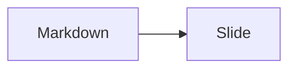
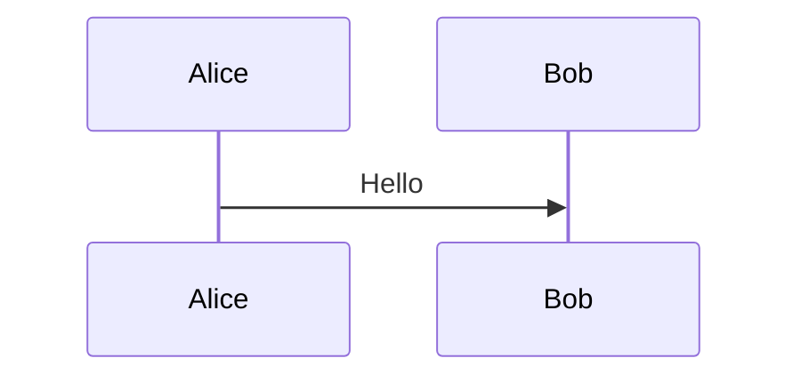
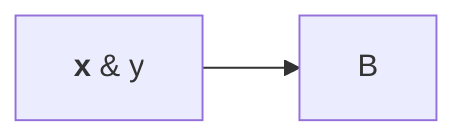
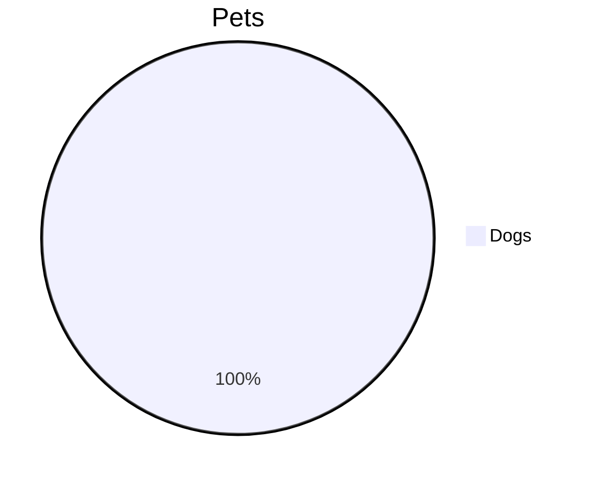

# Mermaid diagrams





```mermaid h-300 class="big" id="flow" style="width: 50%" aria-label='Flow "A to B"' onclick="alert(1)"
flowchart LR
  A --> B
```

~~~mermaid fade-up
stateDiagram-v2
  [*] --> Still
~~~

Text between two diagrams.


<!-- .element: class="fragment" -->

```mermaidjs
not a diagram
```

!!! note
a diagram after an admonition
!!!


